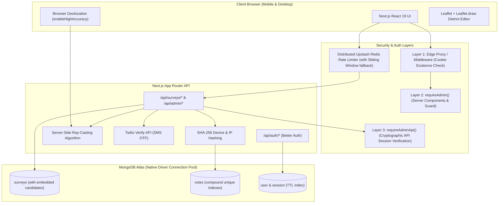

# Digital Udaan Technologies — Production-Grade Geofenced Voting Survey Platform

A production-ready voting survey and ballot auditing web application built with **Next.js 16 (App Router + Turbopack + Cache Components enabled)**, **native MongoDB Atlas driver (no ORM)**, **Better Auth** with the Admin plugin, **Twilio Verify SMS OTP**, **Upstash Redis rate limiting**, **Leaflet + Leaflet.draw polygon geofencing**, and **Tailwind CSS**.

---

## 🏛 Architecture Diagram



---

## ⚡ Tech Stack & Highlights

- **Framework**: Next.js 16+ (App Router, Turbopack, TypeScript strict mode, React 19)
- **Caching**: Next.js Cache Components (`cacheComponents: true`, `partialPrefetching: true`) with `<Suspense>` streaming
- **Database**: Native MongoDB Atlas driver (`mongodb@^7.7.0`) — **strictly NO Prisma and NO Mongoose**
- **Authentication**: Better Auth with native MongoDB adapter & Admin plugin
- **OTP Verification**: Twilio Verify v2 API with timeout and exponential retry
- **Geofencing**: Client-side Leaflet polygon boundary editor + server-side Ray-Casting point-in-polygon verification
- **Rate Limiting**: Upstash Redis distributed sliding window with automatic in-memory fallback
- **Input Validation**: Strict Zod schemas on every route, query parameter, and body payload (with HTML tag stripping)
- **Styling**: Tailwind CSS v4, custom UI primitives, Sonner toast notifications, Lucide icons

---

## 📋 Folder Structure

```
├── .env.example
├── .env.local
├── eslint.config.mjs
├── next.config.ts
├── package.json
├── README.md
├── tsconfig.json
├── scripts/
│   ├── setup-indexes.ts       # Idempotent MongoDB index setup script
│   └── promote-admin.ts       # CLI tool to promote users to administrator
└── src/
    ├── app/
    │   ├── (auth)/
    │   │   ├── login/
    │   │   │   └── page.tsx   # Login page
    │   │   └── register/
    │   │       └── page.tsx   # Signup page (defaults to 'user' role)
    │   ├── admin/
    │   │   ├── layout.tsx     # Layer 2 requireAdmin() server guard
    │   │   ├── page.tsx       # Admin dashboard with stats cards
    │   │   ├── surveys/
    │   │   │   ├── page.tsx   # Survey list + cascade delete
    │   │   │   ├── new/
    │   │   │   │   └── page.tsx # New survey creation + Leaflet boundary editor
    │   │   │   └── [id]/
    │   │   │       ├── page.tsx # Edit survey & candidate manager
    │   │   │       └── votes/
    │   │   │           └── page.tsx # Paginated audited votes table
    │   ├── api/
    │   │   ├── admin/
    │   │   │   ├── candidates/[id]/route.ts  # Update/delete candidate
    │   │   │   ├── surveys/
    │   │   │   │   ├── route.ts              # List/create surveys
    │   │   │   │   └── [id]/
    │   │   │   │       ├── route.ts          # Detail/update/delete survey (cascade votes)
    │   │   │   │       ├── candidates/route.ts # Add candidate
    │   │   │   │       └── votes/route.ts    # Paginated votes query
    │   │   ├── auth/[...all]/route.ts        # Better Auth endpoint
    │   │   └── surveys/[id]/
    │   │       ├── route.ts                  # Public survey details & standings
    │   │       ├── send-otp/route.ts         # Twilio OTP dispatch + phone/IP rate limit
    │   │       ├── verify-location/route.ts  # Ray-casting geofence check
    │   │       └── vote/route.ts             # Atomic vote casting + SHA-256 + 11000 check
    │   ├── favicon.ico
    │   ├── globals.css
    │   ├── layout.tsx         # Root layout with Nav, Providers, Sonner toaster
    │   ├── not-found.tsx      # Custom 404 page
    │   ├── page.tsx           # Public homepage with active surveys list
    │   └── survey/[id]/
    │       ├── page.tsx       # 3-step voter wizard
    │       └── results/
    │           └── page.tsx   # Live results with auto-refresh every 10s
    ├── components/
    │   ├── admin/
    │   │   ├── candidate-manager.tsx
    │   │   ├── survey-editor.tsx
    │   │   └── vote-table.tsx
    │   ├── nav.tsx
    │   ├── polygon-editor-inner.tsx
    │   ├── polygon-editor.tsx
    │   ├── providers.tsx
    │   ├── results-client.tsx
    │   ├── ui/
    │   │   ├── badge.tsx
    │   │   ├── button.tsx
    │   │   ├── card.tsx
    │   │   ├── input.tsx
    │   │   ├── label.tsx
    │   │   ├── skeleton.tsx
    │   │   └── textarea.tsx
    │   └── vote-wizard.tsx    # 3-step client voting wizard
    ├── lib/
    │   ├── admin-guard.ts     # Layer 2: Server Component admin authorization
    │   ├── api-auth.ts        # Layer 3: requireAdminApi() endpoint guard
    │   ├── auth-client.ts     # Better Auth React client + admin plugin
    │   ├── auth.ts            # Better Auth server configuration
    │   ├── env.ts             # Zod environment variable validation
    │   ├── geo.ts             # Ray-casting point-in-polygon algorithm
    │   ├── logger.ts          # Production logger (no console.log in prod)
    │   ├── mongodb.ts         # Singleton native MongoDB connection pool
    │   ├── phone.ts           # Twilio Verify client, E.164, SHA-256 hashing, IP extraction
    │   ├── rate-limit.ts      # Upstash Redis & in-memory sliding window limiter
    │   ├── types.ts           # MongoDB collection interfaces
    │   ├── utils.ts           # Tailwind clsx/twMerge utility
    │   └── validators.ts      # Strict Zod validation schemas
    └── middleware.ts          # Layer 1: Edge cookie existence check for /admin/*
```

---

## 🔒 Security Architecture (Defense in Depth)

### 1. Three-Layer Authorization
- **Layer 1 (Edge Middleware)**: `src/middleware.ts` performs a fast cookie existence check for any `/admin/*` route and redirects unauthenticated requests to `/login`.
- **Layer 2 (Server Component Guard)**: `src/lib/admin-guard.ts` executes `requireAdmin()` on every admin page, cryptographically inspecting the session and verifying that `user.role === "admin"`.
- **Layer 3 (API Route Guard)**: `src/lib/api-auth.ts` executes `requireAdminApi(req)` on every administrative API endpoint, returning structured 401 or 403 JSON responses upon authorization failure.

### 2. Voter Data & Uniqueness
- **No ballot phone numbers**: The ballot flow does not request, store, or use mobile numbers.
- **Device hash only**: A SHA-256 hash of the client device identifier is stored for one-vote-per-device enforcement; the raw identifier is not stored.
- **Location and IP auditing**: GPS coordinates and the extracted client IP are retained on each ballot. The IP hash is also retained for lookup and rate limiting.
- **Database-level uniqueness**: The compound `{ surveyId: 1, deviceHash: 1 }` index enforces one ballot per device. IP is informational and is not unique, so voters sharing a network are not blocked.

### 3. Server-Side Geofencing
- Client-provided GPS coordinates are **never trusted blindly**.
- Coordinates are validated on the server using an implementation of the **Jordan Curve Theorem / Ray-Casting Algorithm** (`src/lib/geo.ts`) against the survey's GeoJSON polygon ring.
- Outside coordinates return `403 Forbidden: You are outside the allowed voting area`.

### 4. Distributed Rate Limiting
- `POST /api/surveys/[id]/send-otp`: **3 requests / 10 minutes** per phone + **10 requests / 10 minutes** per IP.
- `POST /api/surveys/[id]/vote`: **5 requests / 10 minutes** per IP.
- Admin endpoints: **100 requests / 1 minute** per admin user.
- Responses return HTTP `429 Too Many Requests` with the `Retry-After` header.

---

## 🚀 Setup & Local Development

### 1. Clone & Install Dependencies
```bash
git clone <repo-url>
cd voter-servay
pnpm install
```

### 2. Configure Environment Variables
Copy `.env.example` to `.env.local`:
```bash
cp .env.example .env.local
```

Fill in your configuration:
```env
MONGODB_URI=mongodb+srv://<username>:<password>@cluster0.ne9jkw8.mongodb.net/?retryWrites=true&w=majority
MONGODB_DB=voting

BETTER_AUTH_SECRET=your_32_character_random_secret_here_min_32_chars
BETTER_AUTH_URL=http://localhost:3000
NEXT_PUBLIC_APP_URL=http://localhost:3000

TWILIO_ACCOUNT_SID=ACXXXXXXXXXXXXXXXXXXXXXXXXXXXXXXXX
TWILIO_API_KEY=SKXXXXXXXXXXXXXXXXXXXXXXXXXXXXXXXX
TWILIO_API_SECRET=your_twilio_secret
TWILIO_VERIFY_SERVICE_SID=VAXXXXXXXXXXXXXXXXXXXXXXXXXXXXXXXX

# Upstash Redis (Optional for dev: in-memory limiter used if unset)
UPSTASH_REDIS_REST_URL=
UPSTASH_REDIS_REST_TOKEN=
```

### 3. Initialize MongoDB Indexes (Idempotent)
Run the automated index migration script:
```bash
pnpm run db:setup
```
This builds all required unique, compound, and TTL indexes on MongoDB Atlas and removes legacy phone/raw-device fields from existing ballots:
- `votes`: `{ surveyId: 1, deviceHash: 1 }` (unique)
- `votes`: `{ surveyId: 1, ipHash: 1 }` (non-unique)
- `votes`: `{ surveyId: 1, candidateId: 1 }`
- `surveys`: `{ isActive: 1, createdAt: -1 }`
- `user`: `{ email: 1 }` (unique)
- `session`: `{ token: 1 }` (unique)
- `session`: `{ expiresAt: 1 }` (TTL index)

### 4. Start Development Server
```bash
pnpm run dev
```
Open [http://localhost:3000](http://localhost:3000) in your browser.

---

## 🔑 Promoting Your Account to Admin

Better Auth enforces the default role `"user"` on signup. To grant administrator permissions:

1. Register an account at [http://localhost:3000/register](http://localhost:3000/register).
2. Promote your account using the included CLI utility:
   ```bash
   pnpm run admin:promote your-email@example.com
   ```
   *(Or in MongoDB mongosh: `db.user.updateOne({ email: "your-email@example.com" }, { $set: { role: "admin" } })`)*
3. Sign in at [http://localhost:3000/login](http://localhost:3000/login) to access the `/admin` portal.

---

## 🌐 Production Deployment Guide

### Vercel Deployment
1. Import your repository into Vercel.
2. In **Project Settings → Environment Variables**, add:
   - `MONGODB_URI`
   - `MONGODB_DB` (e.g. `voting`)
   - `BETTER_AUTH_SECRET` (generate using `openssl rand -base64 32`)
   - `BETTER_AUTH_URL` (`https://your-domain.vercel.app`)
   - `NEXT_PUBLIC_APP_URL` (`https://your-domain.vercel.app`)
   - `TWILIO_ACCOUNT_SID`
   - `TWILIO_API_KEY`
   - `TWILIO_API_SECRET`
   - `TWILIO_VERIFY_SERVICE_SID`
   - `UPSTASH_REDIS_REST_URL`
   - `UPSTASH_REDIS_REST_TOKEN`
3. Deploy! The project compiles via Turbopack with Cache Components enabled.

---

## 🛠 Troubleshooting & Notes

- **MongoDB Atlas SSL / Connection Errors**:
  Ensure your MongoDB Atlas Network Access whitelist includes `0.0.0.0/0` (or Vercel's IP ranges). The singleton in `src/lib/mongodb.ts` includes `connectTimeoutMS: 10000`, `serverSelectionTimeoutMS: 5000`, and automatic connection reuse across serverless invocations.
- **Next.js 16 Cache Components**:
  In Next.js 16 with `cacheComponents: true` and `partialPrefetching: true`, do not use legacy `export const dynamic = "force-dynamic"`. Uncached database calls must either reside inside `<Suspense>` with `await connection()` from `next/server`, or set `export const instant = false;` on blocking Server Components.
- **Twilio Verify in Local Testing**:
  When using mock Twilio keys (e.g. `AC000...`), the system automatically activates a local verification fallback accepting `123456`, allowing end-to-end voting testing without consuming SMS credits.
